# Flutter Architecture Examples

The same small app built six ways, so you can compare how each architecture is put together.

Each example shows a list of characters from the free [Rick and Morty API](https://rickandmortyapi.com). It caches the list on the device, works offline once loaded, and supports pull to refresh. Only the state management and the API style change between them.

| Example | State management | API | Wiring | Code generation |
|---|---|---|---|---|
| [`mobx`](mobx) | MobX | REST | Constructor injection in `main.dart` | Yes, for stores |
| [`mobx_graphql`](mobx_graphql) | MobX | GraphQL | Constructor injection in `main.dart` | Yes, for stores |
| [`riverpod`](riverpod) | Riverpod 3 | REST | Providers | No |
| [`bloc_cubit`](bloc_cubit) | Bloc: `Cubit` | REST | `RepositoryProvider` and `BlocProvider` | No |
| [`bloc`](bloc) | Bloc: events and states | REST, with search | `RepositoryProvider` and `BlocProvider` | No |
| [`bloc_advanced`](bloc_advanced) | Bloc for bigger teams | REST, with search | Separate Dart packages, `RepositoryProvider` and `BlocProvider` | No |

All examples use Flutter 3.47 and Dart 3.13.

### Which one should I pick?

- **Small app or a first project:** `riverpod` or `bloc_cubit`. Both are short and need no code generation.
- **You want every state change to have a named reason, or you need debounce and other event control:** `bloc`.
- **Several teams work in one app:** `bloc_advanced`. Each layer is a package with its own tests, so teams can work on one part without touching the others.
- **Your team already knows MobX:** `mobx` or `mobx_graphql`.

## The layers

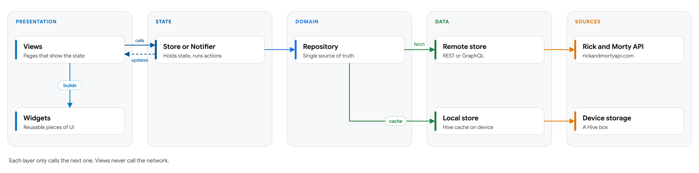

Every example has the same four layers. Each layer only calls the next one. The `Character` model is shared by all of them.

| Layer | What it does | Where it lives |
|---|---|---|
| Presentation | Pages and widgets. Shows the state and sends user actions. | `characters/views`, `characters/widgets` |
| State | Holds the screen state and calls the repository. | `characters/presentation` |
| Domain | The repository. Decides whether to use the cache or the network. | `core/domain` |
| Data | Talks to the API and to local storage. | `core/data` |

The repository is the only place that knows about caching. It returns cached characters if it has any, and otherwise fetches them and saves them. If the network fails, it falls back to the cache.

## Project structure

```
lib
├── main.dart
├── core
│   ├── data
│   │   ├── api          # API endpoints and clients
│   │   ├── models       # Character
│   │   ├── local        # Hive cache
│   │   └── remote       # REST or GraphQL
│   ├── domain
│   │   └── repositories # CharactersRepository
│   └── providers.dart   # Riverpod only
└── characters
    ├── presentation     # The store, notifier, cubit or bloc
    ├── views            # CharactersPage
    └── widgets          # CharacterTile
```

`bloc_advanced` is laid out the way larger teams usually split a Bloc app:

```
bloc_advanced
├── packages
│   ├── rick_and_morty_api     # Data: HTTP and JSON, returns ApiCharacter
│   └── characters_repository  # Domain: Character, cache rules, CharactersCache
└── lib
    ├── bootstrap.dart         # BlocObserver, error logging, dependencies
    ├── app                    # App, AppBlocObserver
    ├── cache                  # HiveCharactersCache
    └── characters             # One folder per feature
        ├── bloc               # CharactersBloc, with events and state as part files
        ├── view               # CharactersPage and CharactersView
        └── widgets
```

## MobX + REST

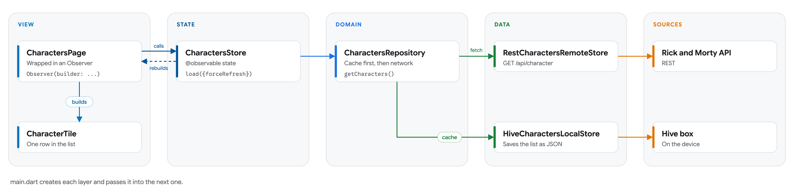

`CharactersStore` holds `@observable` fields and a `load` action. The page wraps its body in an `Observer`, so it rebuilds whenever the store changes. `main.dart` creates each layer and passes it into the next one.


See [`mobx`](mobx).

## MobX + GraphQL

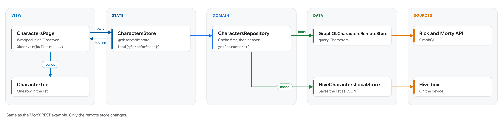

The same as the REST example. Only the remote store changes. It sends a GraphQL query instead of a REST request, and returns the same `Character` model, so nothing above the data layer changes.

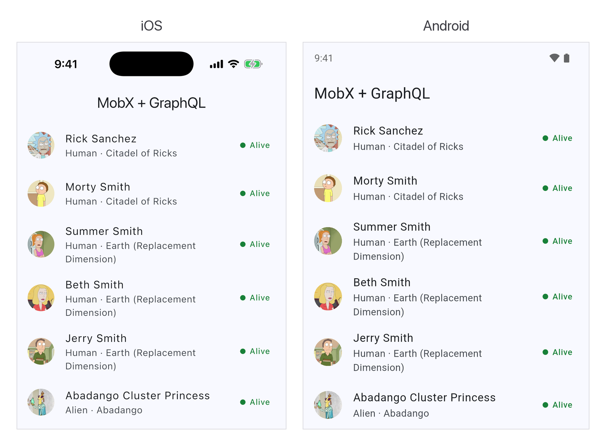

See [`mobx_graphql`](mobx_graphql).

## Riverpod + REST

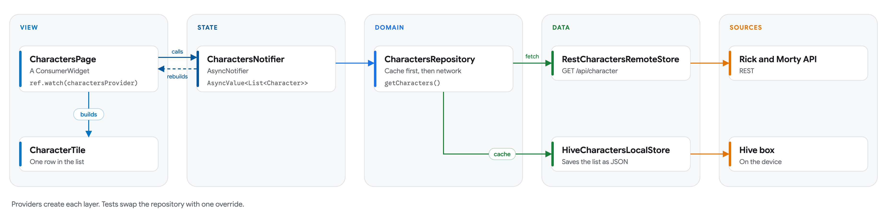

`CharactersNotifier` is an `AsyncNotifier`. Its state is an `AsyncValue`, which already covers loading and error states. Providers in `core/providers.dart` create each layer. In tests, one override swaps the repository for a fake.

```dart
ProviderScope(
  overrides: [charactersRepositoryProvider.overrideWithValue(FakeRepository())],
  child: const MaterialApp(home: CharactersPage(title: 'Riverpod')),
)
```

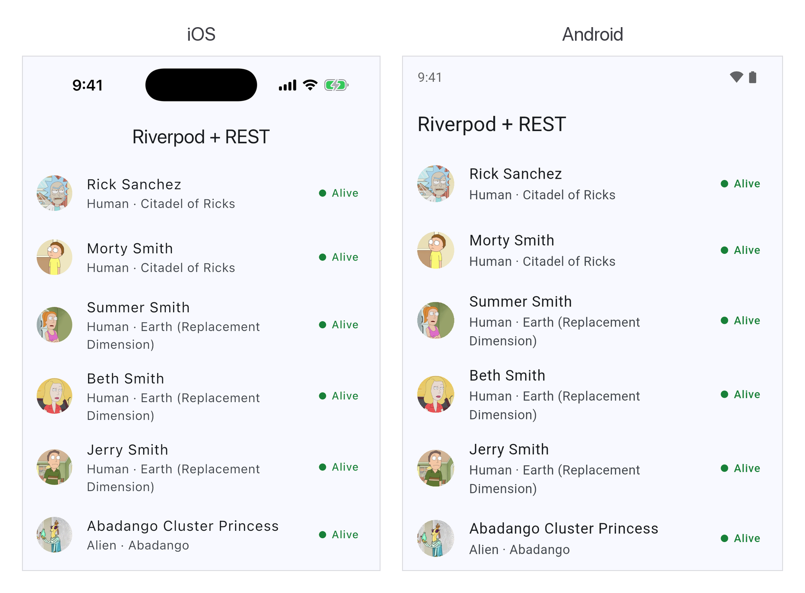

See [`riverpod`](riverpod).

## Bloc: Cubit

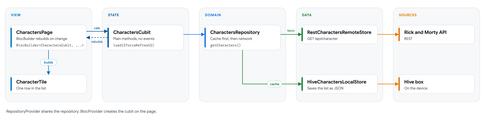

The simplest way to use the bloc package. `CharactersCubit` has a plain `load` method that calls `emit`. The state is one class with a `status` enum, so the list stays on screen while a refresh runs. The bloc docs suggest starting with a `Cubit` and moving to a `Bloc` when you need events.

```dart
Future<void> load({bool forceRefresh = false}) async {
  if (state.status == CharactersStatus.loading) return;
  emit(state.copyWith(status: CharactersStatus.loading));
  // ...
}
```

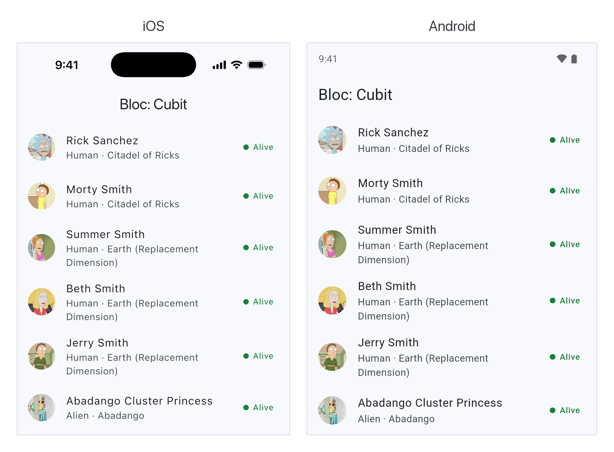

See [`bloc_cubit`](bloc_cubit).

## Bloc: events

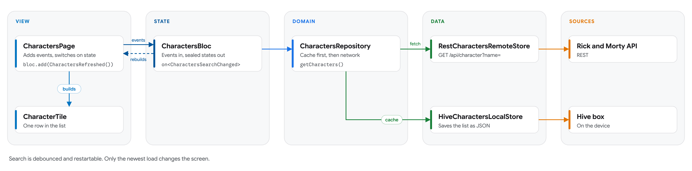

`CharactersBloc` turns events into states. Events are named in the past tense (`CharactersStarted`, `CharactersRefreshed`, `CharactersSearchChanged`), and the state is a `sealed` class, so the view's `switch` must handle every state.

Each event picks how it handles overlapping events, using [`bloc_concurrency`](https://pub.dev/packages/bloc_concurrency):

| Event | Transformer | Why |
|---|---|---|
| `CharactersSearchChanged` | Debounce, then `restartable` | Wait until the user stops typing, then cancel any older search. |
| `CharactersRefreshed` | `droppable` | Ignore extra pulls while a refresh runs. |
| `CharactersStarted` | `droppable` | Ignore extra taps on retry. |

A `BlocObserver` logs every transition, so you can see which event caused each change.

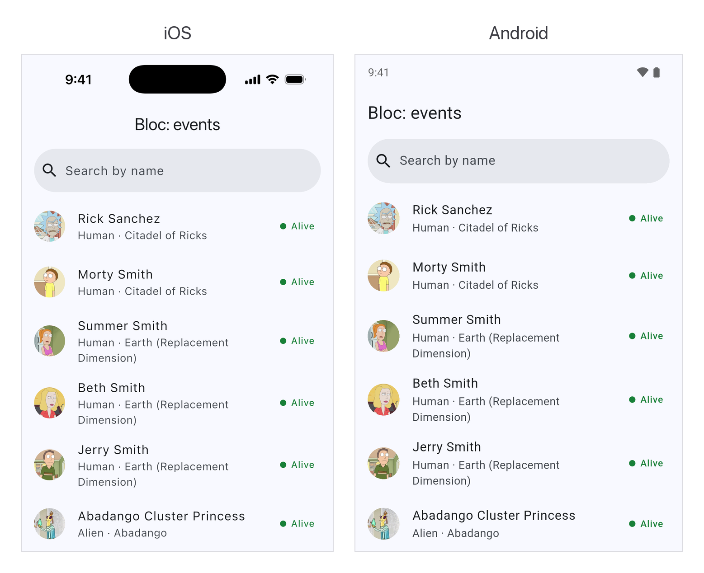

See [`bloc`](bloc).

## Bloc: bigger teams

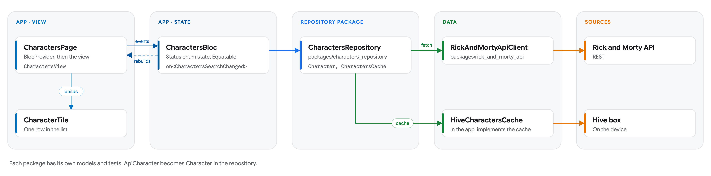

The same features as `bloc`, set up for a large codebase:

- **Packages per layer.** `rick_and_morty_api` only knows HTTP and returns `ApiCharacter`. `characters_repository` turns those into its own `Character` model and owns the cache rules. Each has its own tests and can be versioned on its own.
- **The cache is an interface.** The repository package defines `CharactersCache`, and the app provides `HiveCharactersCache`, so the packages have no Flutter or database dependency.
- **Feature folders.** Everything for the characters screen lives in `lib/characters`.
- **A status enum state.** The screen keeps showing the list while loading, and shows a snackbar if a refresh fails instead of hiding the list.
- **Page and view are split.** `CharactersPage` provides the bloc, and `CharactersView` only renders. View tests use a `MockBloc`, so they don't run any bloc logic.
- **Strict lints** with [`very_good_analysis`](https://pub.dev/packages/very_good_analysis).


See [`bloc_advanced`](bloc_advanced).

## Running the examples

You need Flutter 3.47 or later.

```bash
make pubs                  # get dependencies for every example
make run app=riverpod      # run one example
make check                 # analyze and test every example and package
make codegen app=mobx      # regenerate MobX code after changing a store
```

No API key is needed.

## Tests

Every example tests the same behavior:

- The repository's caching rules, with a fake remote and local store.
- The remote store's parsing and error handling, with a mock HTTP client.
- The page: it shows the characters, shows an error with a working retry button, and skips the cache on pull to refresh.

The Bloc examples also test the cubit or bloc with [`bloc_test`](https://pub.dev/packages/bloc_test), including the debounce and the ignored extra refresh. `bloc_advanced` tests each package with `dart test`, and its view with a mock bloc.

## Diagrams

The diagrams are generated from [`docs/diagrams/generate.py`](docs/diagrams/generate.py). To update them, edit that file and run `make diagrams`. This needs macOS, Python 3 and Google Chrome.

## Further reading

- [Bloc architecture](https://bloclibrary.dev/architecture/), [naming conventions](https://bloclibrary.dev/naming-conventions/) and [modeling state](https://bloclibrary.dev/modeling-state/)
- [Very Good Flutter Architecture](https://verygood.ventures/blog/very-good-flutter-architecture)
- [Riverpod](https://riverpod.dev) and [MobX](https://mobx.netlify.app)

## Credits

The character data and images come from the [Rick and Morty API](https://rickandmortyapi.com). Rick and Morty was created by Justin Roiland and Dan Harmon for Adult Swim.
