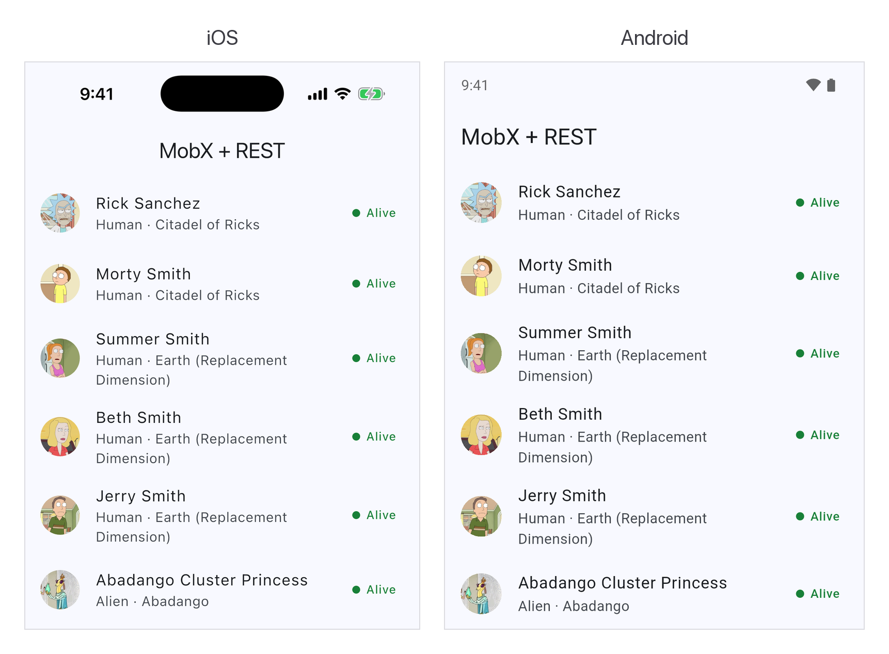

# Flutter Architecture Examples

The same small app built three ways, so you can compare how each architecture is put together.

Each example shows a list of characters from the free [Rick and Morty API](https://rickandmortyapi.com). It caches the list on the device, works offline once loaded, and supports pull to refresh. Only the state management and the API style change between them.

| Example | State management | API | Wiring | Code generation |
|---|---|---|---|---|
| [`mobx`](mobx) | MobX | REST | Constructor injection in `main.dart` | Yes, for stores |
| [`mobx_graphql`](mobx_graphql) | MobX | GraphQL | Constructor injection in `main.dart` | Yes, for stores |
| [`riverpod`](riverpod) | Riverpod 3 | REST | Providers | No |

All three use Flutter 3.47 and Dart 3.13.

## The layers


Every example has the same four layers. Each layer only calls the next one. The `Character` model is shared by all of them.

| Layer | What it does | Where it lives |
|---|---|---|
| Presentation | Pages and widgets. Shows the state and sends user actions. | `characters/views`, `characters/widgets` |
| State | Holds the screen state and calls the repository. | `characters/presentation` |
| Domain | The repository. Decides whether to use the cache or the network. | `core/domain` |
| Data | Talks to the API and to local storage. | `core/data` |

The repository is the only place that knows about caching. It returns cached characters if it has any, and otherwise fetches them and saves them. If the network fails, it falls back to the cache.

## Project structure

```
lib
├── main.dart
├── core
│   ├── data
│   │   ├── api          # API endpoints and clients
│   │   ├── models       # Character
│   │   ├── local        # Hive cache
│   │   └── remote       # REST or GraphQL
│   ├── domain
│   │   └── repositories # CharactersRepository
│   └── providers.dart   # Riverpod only
└── characters
    ├── presentation     # CharactersStore (MobX) or CharactersNotifier (Riverpod)
    ├── views            # CharactersPage
    └── widgets          # CharacterTile
```

## MobX + REST


`CharactersStore` holds `@observable` fields and a `load` action. The page wraps its body in an `Observer`, so it rebuilds whenever the store changes. `main.dart` creates each layer and passes it into the next one.



See [`mobx`](mobx).

## MobX + GraphQL


The same as the REST example. Only the remote store changes. It sends a GraphQL query instead of a REST request, and returns the same `Character` model, so nothing above the data layer changes.


See [`mobx_graphql`](mobx_graphql).

## Riverpod + REST


`CharactersNotifier` is an `AsyncNotifier`. Its state is an `AsyncValue`, which already covers loading and error states. Providers in `core/providers.dart` create each layer. In tests, one override swaps the repository for a fake.

```dart
ProviderScope(
  overrides: [charactersRepositoryProvider.overrideWithValue(FakeRepository())],
  child: const MaterialApp(home: CharactersPage(title: 'Riverpod')),
)
```


See [`riverpod`](riverpod).

## Running the examples

You need Flutter 3.47 or later.

```bash
make pubs                  # get dependencies for every example
make run app=riverpod      # run one example
make check                 # analyze and test every example
make codegen app=mobx      # regenerate MobX code after changing a store
```

No API key is needed.

## Tests

Each example has the same tests:

- `characters_repository_test.dart` checks the caching rules with a fake remote and local store.
- `characters_page_test.dart` checks that the page shows the characters, and shows an error with a working retry button.

## Diagrams

The diagrams are generated from [`docs/diagrams/generate.py`](docs/diagrams/generate.py). To update them, edit that file and run `make diagrams`. This needs macOS, Python 3 and Google Chrome.

## Credits

The character data and images come from the [Rick and Morty API](https://rickandmortyapi.com). Rick and Morty was created by Justin Roiland and Dan Harmon for Adult Swim.
